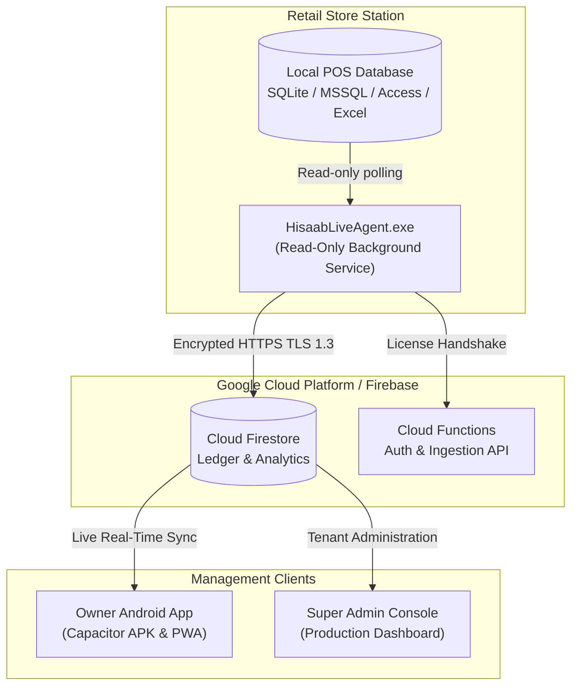

<div align="center">

# ⚡ HisaabLive (حساب لائیو)
### *Next-Generation Real-Time POS Telemetry, Loss Prevention & Multi-Tenant Retail Ledger*

[](LICENSE)
[](https://github.com/Wahi-ur-rehman/Hisaab-Live-/actions)
[](https://github.com/Wahi-ur-rehman/Hisaab-Live-/actions)
[](https://firebase.google.com/)
[](https://react.dev/)
[](https://capacitorjs.com/)

---

**HisaabLive** bridges on-premise retail billing systems (POS software running on desktop computers) with real-time cloud analytics, mobile apps, and loss-prevention telemetry. It gives store owners instant visibility into cash registers from their phones while stopping cashier fraud and unrecorded sales.

</div>

---

## 🌟 Key Highlights

### 🛡️ 1. Cryptographic Anti-Tamper & Fraud Detection
* **Real-Time Audit Ledger:** Monitors POS databases every 10–30 seconds.
* **Catches Insider Theft:** Automatically flags when cashiers delete receipts, retroactively lower totals, apply unauthorized discounts, or wipe transaction sequences.
* **Silent Agent Heartbeat:** Detects when the POS PC is unplugged or the agent is forcefully stopped during operational hours.

### 📱 2. Shop Owner Mobile App (`owner-app`)
* **Real-Time Live Dashboard:** Instant updates for today's sales, bills, and active registers.
* **Bilingual Experience:** 1-tap language toggle between **Urdu (اردو)** and **English**.
* **Smart Khata (Customer Credit Ledger):** Track customer debts (*Udhaar Diya*) and payments (*Wasoool Hua*) with real-time customer balances.
* **Expense Tracking & Deletion:** Categorized daily expenses (*Chai/Pani, Bijli, Rent, etc.*).
* **1-Tap Monthly PDF Statements:** Formatted statements with totals, breakdowns, and download capability using `jsPDF`.
* **Cross-Platform:** Runs as an installable Android APK (via Capacitor v6) and high-performance Web App (PWA).

### 🖥️ 3. Silent Windows Background Agent (`agent`)
* **Universal Database Compatibility:** SQLite (`.db`, `.sqlite`), Microsoft SQL Server, Microsoft Access (`.accdb`, `.mdb`), Excel (`.xlsx`), and CSV.
* **Zero Firebase Credentials on PC:** Authenticates strictly via ephemeral setup tokens and cryptographic license hashes.
* **SYSTEM Security:** Installs in `C:\Program Files\HisaabLive` with hardened ACLs; launches silently at system boot via Windows Task Scheduler (`schtasks`).

### 👑 4. Super Admin Console (`super-admin`)
* **Tenant Lifecycle Management:** Register shops, assign 6-digit owner PINs, monitor active vs expired subscriptions.
* **One-Click Licensing:** Generate 48-hour secure onboarding codes or revoke PC licenses in 1 click if a computer is decommissioned.
* **Eye-Comfort Dark Mode:** Low-glare palette designed for high-density administrative tasks.

---

## 🏗️ System Architecture



---

## 📁 Repository Structure

```text
├── .github/workflows/          # CI/CD Automated Pipelines
│   ├── build-apk.yml           # Compiles Android APK in the cloud
│   └── build-agent-exe.yml     # Compiles Windows HisaabLiveAgent.exe
├── agent/                      # POS Windows Agent (Node.js + Pkg)
│   ├── agent.js                # Core background sync service
│   ├── setup.js                # Interactive POS column discovery
│   ├── automap.js              # Heuristic column detection engine
│   ├── installer.js            # Hardened Windows Task Scheduler installer
│   └── connectors/             # SQLite, MSSQL, Access, Excel, CSV drivers
├── owner-app/                  # Shop Owner Mobile & Web Application
│   ├── src/                    # React 18 UI with eye-comfort styling
│   ├── capacitor.config.json   # Capacitor Android build configuration
│   └── android/                # Native Android Gradle workspace
├── super-admin/                # Multi-Tenant Super Admin Management Portal
│   └── src/Admin.jsx           # Live shop provisioning, telemetry & licensing
├── firebase/                   # Cloud Functions & Security Rules
│   ├── functions/              # Backend validation and billing logic
│   └── firestore.rules         # Dual-Mode (Spark + Blaze) Security Rules
├── SHOP_SETUP_GUIDE.md         # Complete on-site technician & owner manual
└── LICENSE                     # Open-source MIT License
```

---

## 🚀 Quickstart Guide

### 1. Running the Super Admin Portal
```bash
cd super-admin
npm install
npm run dev
```
*Portal runs at: `http://localhost:5173` (or port 4174 in preview mode)*

### 2. Running the Owner App Locally
```bash
cd owner-app
npm install
npm run dev
```
*App runs at: `http://localhost:5173` (or port 4173 in preview mode)*

### 3. Downloading Pre-Built Binaries (Zero Setup)
You don't need to install Android Studio or Windows build tools locally:
* **Android APK (`HisaabLive.apk`):** Download the latest build from the [GitHub Actions APK Tab](https://github.com/Wahi-ur-rehman/Hisaab-Live-/actions/workflows/build-apk.yml).
* **Windows Agent (`HisaabLiveAgent.exe`):** Download from the [GitHub Actions POS Agent Tab](https://github.com/Wahi-ur-rehman/Hisaab-Live-/actions/workflows/build-agent-exe.yml).

---

## 📖 Deployment & Shop Onboarding

For detailed instructions on deploying the agent on cash registers and configuring databases, consult the official guide:

👉 **[Read the Complete Shop Setup & POS Agent Deployment Guide (SHOP_SETUP_GUIDE.md)](SHOP_SETUP_GUIDE.md)**

---

## 🔒 Security & Compliance

* **Zero-Credential Edge:** The local shop agent contains no Firebase API keys, administrative service accounts, or database passwords. It only stores an encrypted session token.
* **Dual-Mode Hybrid Rules:** Firestore security rules seamlessly auto-detect whether your Firebase project is running on the free **Spark Plan** or the paid **Blaze Plan** without breaking queries.
* **Hardened File System:** On Windows POS computers, the agent isolates itself in `C:\Program Files\HisaabLive\` with `SYSTEM` and `Administrators`-only DACLs (`icacls`), preventing unauthorized tampering by store employees.

---

## 📄 License

This project is licensed under the **MIT License** — see the [LICENSE](LICENSE) file for details.

Developed with precision by [Wahi-ur-rehman](https://github.com/Wahi-ur-rehman).
